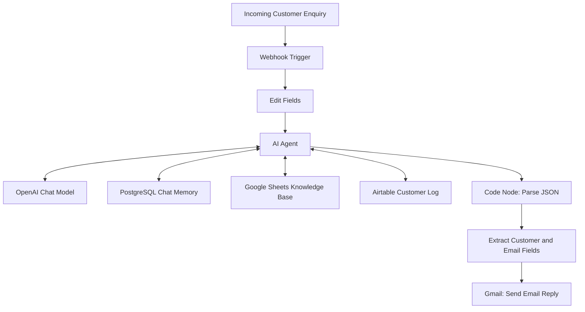

# 🚚 247 Delivery — AI Customer Support Agent

An AI-powered customer support automation system built with **n8n** that helps 247 Delivery respond to customer enquiries, retrieve business information from Google Sheets, log customer details in Airtable, and generate professional email replies using AI.

## 📌 Project Overview

The 247 Delivery Customer Support AI Agent automates key customer service tasks by combining AI-powered natural language processing with workflow automation and business data management.

Customers can submit enquiries through a configured webhook or other supported communication channel. The workflow processes the message, retrieves relevant information from the company's knowledge base, records the enquiry in Airtable, and generates a structured email response.

The goal is to improve response consistency, reduce manual work, maintain customer enquiry records, and support faster customer service.

## 🎯 Project Objectives

- Automate responses to frequently asked customer questions.
- Use a Google Sheets knowledge base as the source of company information.
- Capture and store customer details in Airtable.
- Generate professional email replies with separate subject and body fields.
- Reduce repetitive manual customer support tasks.
- Maintain a record of customer enquiries for follow-up.
- Provide a foundation for future customer support automation.

## 🛠️ Technologies and Integrations

| Technology | Purpose |
|---|---|
| [n8n](https://n8n.io/) | Workflow automation and orchestration |
| OpenAI Chat Model | Understands customer messages and generates responses |
| Google Sheets | Stores the customer support knowledge base |
| Airtable | Stores customer details and enquiry records |
| Gmail | Sends email replies to customers |
| PostgreSQL Chat Memory | Provides conversation memory to the AI Agent |
| Railway | Hosts the self-hosted n8n instance |

## 🏗️ Workflow Architecture

The workflow connects incoming customer messages to an AI Agent and the relevant business tools.



**Note:** The diagram represents the intended end-to-end workflow. The exact node connections and execution order depend on the final n8n configuration. If the AI Agent is connected to Airtable as a tool, Airtable logging is performed when the agent calls that tool.

## ⚙️ How It Works

### 1. Customer enquiry received

The workflow starts when a customer submits a message through the configured webhook or communication channel.

The message may contain a general question, a delivery request, a complaint, or a request for assistance.

### 2. Input processing

The Edit Fields node prepares and maps the incoming data into a consistent format for the AI Agent.

Typical input fields include:

- Customer name
- Customer email
- Customer phone number
- Customer message

The actual fields depend on the incoming request and the workflow configuration.

### 3. AI-powered customer support

The AI Agent uses an OpenAI Chat Model to interpret the customer's request and generate a suitable response.

It follows the system instructions configured for 247 Delivery and uses the connected tools when necessary.

### 4. Google Sheets knowledge retrieval

The `247_Delivery_Knowledge_Base` tool retrieves relevant business information from Google Sheets.

The knowledge base can contain:

- Delivery services
- Delivery locations and coverage
- Delivery charges
- Estimated delivery times
- Booking procedures
- Payment methods
- Operating hours
- Customer support policies
- Frequently asked questions

The agent should use verified knowledge base information rather than inventing company policies or delivery details.

### 5. Customer details logged in Airtable

The `247_Delivery_Customer_Log` tool creates a record in the Airtable `Customer Enquiries` table.

The configured fields include:

| Airtable field | Description |
|---|---|
| `Name` | Customer's name |
| `email` | Customer's email address |
| `phone number` | Customer's phone number |
| `message` | Customer's enquiry or message |

The agent is instructed to call the Airtable tool once per incoming enquiry, avoid repeated create-record calls, and report success only when the tool confirms that the record was created.

### 6. JSON parsing with a Code node

The AI Agent returns a structured response containing customer information and the proposed email reply.

Because the response may arrive as a JSON string inside the `output` field, a JavaScript Code node parses the string into individual fields that downstream n8n nodes can map.

The parsed output includes:

- `customer_name`
- `customer_email`
- `customer_phone`
- `customer_message`
- `customer_summary`
- `email_subject`
- `email_body`
- `airtable_log_status`
- `needs_human_follow_up`

### 7. Email reply generation and delivery

The workflow uses the generated subject and body in the Gmail node to prepare and send the customer's email reply.

The recipient is taken from the customer's email address. If no valid address is available, the workflow should handle the missing address rather than attempting to send an email to an empty recipient.

## 📂 Repository Structure

A suggested repository structure is:

```text
247-delivery-ai-customer-support/
│
├── README.md
├── workflows/
│   └── 247-delivery-customer-support.json
├── knowledge-base/
│   └── 247_delivery_knowledge_base.csv
├── docs/
│   └── workflow-architecture.png
├── .gitignore
└── LICENSE
```

The workflow JSON, knowledge base CSV, architecture image, and licence are optional repository files. Add them only when you have prepared the corresponding files.

**Important:** Remove credentials, API keys, customer personal information, and other sensitive data from exported workflow files before uploading them to GitHub.

## 🚀 Installation and Setup

### Prerequisites

Before setting up the workflow, you need:

- An n8n instance, either self-hosted or cloud-hosted.
- An OpenAI API connection configured in n8n.
- A Google account with access to the knowledge base spreadsheet.
- An Airtable account with a configured customer enquiries table.
- A Gmail connection with the required permissions, if using Gmail to send replies.
- A PostgreSQL connection if using PostgreSQL Chat Memory.
- A configured webhook or other supported trigger for incoming customer enquiries.

### Step 1: Set up the Google Sheets knowledge base

1. Create a Google spreadsheet named `247 Delivery Knowledge Base`.
2. Add columns such as `category`, `question`, `answer`, and `keywords`.
3. Populate the sheet with verified information about your services and policies.
4. Connect Google Sheets to n8n.
5. Configure the `247_Delivery_Knowledge_Base` tool to retrieve relevant information.

### Step 2: Configure Airtable

1. Create an Airtable base named `Customer Support`.
2. Create a table named `Customer Enquiries`.
3. Add the fields `Name`, `email`, `phone number`, and `message`.
4. Connect Airtable to n8n using an authorised credential.
5. Configure the Airtable tool to create records in the correct table.
6. Test record creation before connecting it to the AI Agent.

### Step 3: Configure the AI Agent

1. Add an AI Agent node to the n8n workflow.
2. Connect the OpenAI Chat Model.
3. Add the Google Sheets knowledge base tool.
4. Add the Airtable customer logging tool.
5. Configure the system prompt to enforce accurate answers, customer logging, and structured JSON output.
6. Configure chat memory if required by the use case.

### Step 4: Configure JSON parsing

1. Add a Code node after the AI Agent.
2. Set its mode to `Run Once for Each Item`.
3. Parse the AI Agent's `output` string using `JSON.parse()`.
4. Return the parsed fields in the node's `json` object.
5. Test the node with a complete JSON response before connecting the downstream email node.

### Step 5: Configure Gmail

Map the parsed fields to the appropriate Gmail node inputs:

| Gmail field | n8n expression |
|---|---|
| To | `{{ $json.customer_email }}` |
| Subject | `{{ $json.email_subject }}` |
| Message body | `{{ $json.email_body }}` |

Confirm the recipient address is present and valid before attempting to send the email.

### Step 6: Test the complete workflow

Test the workflow with different scenarios:

- A general question about delivery services.
- A question about delivery charges.
- A new delivery request.
- A delayed delivery complaint.
- A message with missing customer details.
- A question that cannot be answered from the knowledge base.
- An Airtable failure.
- An incomplete or invalid AI-generated JSON response.

Verify that the appropriate answer is generated, the Airtable tool is called as intended, the JSON parses correctly, and the email node receives the correct fields.

## 📤 Expected AI Agent Output

The AI Agent is designed to return a JSON object in the following format:

```json
{
  "customer_name": "Tom",
  "customer_email": "tom@example.com",
  "customer_phone": "0712345678",
  "customer_message": "Who owns 247 Delivery?",
  "customer_summary": "Tom asked about the ownership of 247 Delivery.",
  "email_subject": "Re: Your enquiry about 247 Delivery",
  "email_body": "Hello Tom,\n\nThank you for contacting 247 Delivery. Our available customer support knowledge base does not contain verified ownership details. We recommend contacting the appropriate official business registration authority for confirmation.\n\nKind regards,\n247 Delivery Customer Support Team",
  "airtable_log_status": "Saved",
  "needs_human_follow_up": true
}
```

This is an illustrative example. The agent must use the actual customer details and tool results from each execution. The `Saved` status must only be returned when Airtable confirms successful record creation.

## 🔐 Security and Privacy

Customer support systems may process personal information. Apply the following safeguards:

- Store API keys and credentials in n8n credentials or an approved secrets manager.
- Never commit access tokens, passwords, API keys, or private webhook secrets to GitHub.
- Do not upload real customer records or personal information into a public repository.
- Use fictional customer data when testing and documenting the workflow.
- Restrict access to the Airtable base, Google Sheet, Gmail account, and n8n instance.
- Collect only customer information needed for the enquiry or delivery.
- Review the workflow before publishing or enabling automatic customer emails.
- Follow applicable data protection requirements, including Kenya's Data Protection Act where relevant.

## ⚠️ Current Limitations and Considerations

- The agent can only answer business questions supported by the knowledge base or other authorised sources.
- Current parcel tracking requires an authorised tracking source; Google Sheets alone does not establish live delivery status.
- Delivery prices and timelines must be kept up to date.
- Missing customer contact details may prevent an email from being sent.
- AI-generated JSON must be complete and valid before it can be parsed.
- Airtable tool calls may fail due to credentials, permissions, field mapping, or service errors.
- An AI instruction to call Airtable once is not a technical guarantee. Execution logs and workflow design should be used to monitor repeated calls and duplicate records.
- Automatic replies should be monitored, particularly for complaints, refunds, unusual delivery requests, and enquiries that require staff intervention.

## 🔮 Future Improvements

Potential enhancements include:

- Integration with a live parcel tracking system.
- Automatic generation of delivery reference numbers.
- Customer enquiry categorisation and prioritisation.
- Automated escalation of unresolved complaints.
- WhatsApp or Telegram customer support integration.
- Duplicate enquiry detection.
- Delivery booking and status-update automation.
- Analytics dashboard for enquiry volume and response times.
- Customer satisfaction feedback collection.
- Human approval for sensitive or high-impact responses.

## 🤝 Contributing

Suggestions and improvements are welcome.

1. Fork the repository.
2. Create a feature branch.
3. Make and test your changes.
4. Submit a pull request describing the improvement.

Do not include live credentials, private customer records, or production secrets in contributions.

## 📄 License

Choose a licence before distributing this project publicly. For example, the MIT License may be suitable if you want others to use, modify, and distribute the code under its terms. Add the complete licence text to a `LICENSE` file if you choose it.

## 👤 Project Information

**Project:** 247 Delivery Customer Support AI Agent  
**Platform:** n8n  
**Primary purpose:** AI-assisted customer support, knowledge retrieval, customer enquiry logging, and email reply generation.

---

*Built to help 247 Delivery streamline customer support through AI and workflow automation.*
